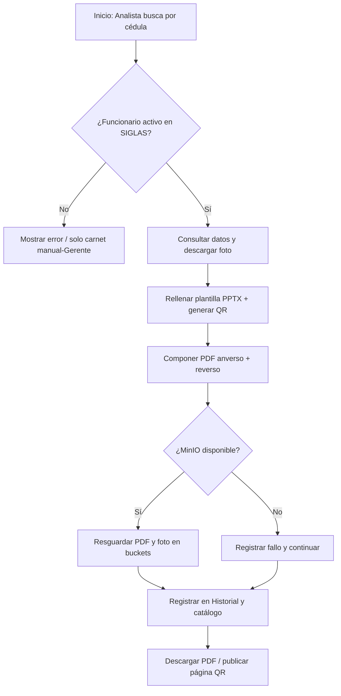

# [PRO-SIS-005] Sistema de Generación y Resguardo de Carnets (Carnets-BD-SIGLAS)

| Ficha Técnica | Detalle |
|---|---|
| **Código Documental:** | `PRO-SIS-005` |
| **Versión Actual:** | `v1.0.0` |
| **Departamento:** | `Sistemas` / `Tecnología e Información` |
| **Sistema:** | Carnets-BD-SIGLAS (Generación y Resguardo de Carnets Institucionales) |
| **Repositorios Git:** | Origen de desarrollo: `TecDarliana/Carnets` — Destino por sincronización: `fundayacucho/carnets-bd-siglas` |
| **Tecnología Base:** | Python 3.11 · Django 5.1 · SQLite (local) · PostgreSQL SIGLAS (solo lectura) · MinIO (S3) |
| **Elaborado Por:** | `[NOMBRE / CARGO]` |
| **Revisado Por:** | `[Coordinador de Área]` |
| **Aprobado Por:** | `[Director de Tecnología]` |
| **Fecha de Última Revisión:** | `2026-10-28` |

---

## 📌 1. Objetivo

Establecer las directrices operativas, arquitectónicas y de desarrollo del **Sistema de Generación y Resguardo de Carnets** de la Fundación Gran Mariscal de Ayacucho. El sistema genera credenciales institucionales en PDF (anverso + reverso) a partir de los datos del personal registrado en **SIGLAS**, los resguarda automáticamente en el clúster **MinIO** institucional y expone una página pública de validación de vigencia accesible desde el código QR impreso en cada carnet.

---

## 🎯 2. Alcance

* **Módulos de la Aplicación (`apps/`):**
  * `carnets`: Módulo principal — consulta de funcionarios, emisión de PDF, historial, plantillas del diseño y resguardo en MinIO.
  * `accounts`: Autenticación, roles institucionales (Consultor / Analista / Gerente) y administración de usuarios.
  * `personas`: Catálogo de empleados con estado de carnet (generado / pendiente) y generación de lotes.
* **Integraciones externas (solo lectura):**
  * BD PostgreSQL de **SIGLAS** (`funcionarios`, `organigrama`) — consulta de datos del personal.
  * Web de SIGLAS — descarga de la fotografía del funcionario por patrón de URL.
  * **MinIO** local (`172.17.9.90:9000`) y **MinIO Cloud** (`https://minio.fundayacucho.gob.ve`) — resguardo e importación histórica.
* **Fuera del alcance:** administración de la BD de SIGLAS (escrituras), configuración del clúster MinIO (ver `minio_guia_administracion.md`) y la emisión de carnets para sistemas distintos al personal de la Fundación.

> [!IMPORTANT]
> El manual de operación para Talento Humano (procedimientos de uso diario) se encuentra en `MANUAL_TALENTO_HUMANO.md` dentro del repositorio del sistema.

---

## 📁 3. Arquitectura y Estructura del Proyecto

```text
carnets/
├── apps/
│   ├── accounts/          # Login, roles, administración de usuarios
│   ├── carnets/           # Núcleo del sistema
│   │   ├── siglas.py      # Consulta BD SIGLAS + generación PDF (reportlab)
│   │   ├── minio_storage.py  # Resguardo S3 (boto3, mejor esfuerzo)
│   │   ├── diseno.py      # Coordenadas, fuentes y fondo del carnet
│   │   ├── models.py      # Carnet, Credencial, HistorialCarnet, ArchivoCarnet, Plantilla
│   │   └── management/commands/
│   │       ├── carnets_importar_historico.py   # Indexa los PDFs/fotos históricos
│   │       └── crear_plantillas_referencia.py
│   └── personas/          # Catálogo de empleados y estado de carnet
├── config/                # settings.py (carga .env vía python-dotenv)
├── templates/             # Vistas HTML (carnets, accounts, personas)
├── static/                # CSS e imágenes
├── credencialfundacion.pptx  # Plantilla PPTX del carnet (marcadores {{...}})
├── arrancar.sh            # Atajo: activa venv y levanta el servidor
├── .env.example           # Copia de referencia de las variables de entorno
├── db.sqlite3             # BD local del sistema (historial, plantillas, usuarios)
└── requirements.txt
```

### 3.1. Componentes técnicos clave

| Componente | Detalle |
|---|---|
| **BD local** | `db.sqlite3` — históricos, credenciales, usuarios y catálogo de MinIO. |
| **BD externa SIGLAS** | PostgreSQL accesible vía `psycopg2` directo (no forma parte de `DATABASES`, por lo que `manage.py migrate` nunca la modificará). |
| **Generación del PDF** | Se consulta el funcionario en SIGLAS, se descarga su foto, se extrae el diseño (imágenes, coordenadas, tipografías Georama) de la plantilla PPTX y se compone el PDF con `reportlab`; el QR se genera con `qrcode`. |
| **Resguardo MinIO** | Cliente S3 (boto3) con firma `s3v4`, timeout de 5 s y 1 reintento. Operación de **mejor esfuerzo**: si MinIO no responde, la emisión, el historial y la validación QR continúan funcionando y se registra el fallo en la bitácora. |
| **Credenciales** | Variables `SIGLAS_*` y `MINIO_*` del archivo `.env` (**nunca versionado**, ver `.gitignore`). |

### 3.2. Convención de objetos en MinIO

| Archivo | Objeto en MinIO |
|---|---|
| Carnet PDF de un funcionario | `carnets-personal/Carnet_<cédula>.pdf` |
| Lote de generación masiva | `carnets-personal/lotes/Carnets_lote_<fecha>.pdf` |
| Fotografía del funcionario | `fotoscarnets/<cédula>.jpg` |
| Históricos (réplica del sistema anterior) | `carnets-personal/historico/` y `fotoscarnets/historico/` |

---

## 🔑 4. Requisitos y Prerrequisitos

### 4.1. Permisos y Accesos Requeridos
- [ ] Conectividad de red institucional hacia `172.17.0.181:5432` (BD SIGLAS) y `172.17.9.90:9000` (MinIO).
- [ ] Credenciales de lectura de la BD de SIGLAS y de la API de MinIO (se suministran por `.env`).
- [ ] Python **3.11** instalado en el equipo servidor o estación de emisión.

### 4.2. Herramientas y Software Necesarios
* Git
* Python 3.11 + `venv`
* Dependencias (ver `requirements.txt`): Django 5.1, psycopg2-binary, boto3, reportlab, pillow, qrcode, python-pptx, python-dotenv, django-widget-tweaks, requests.
* CLI `mc` (MinIO Client) — únicamente para la réplica de históricos (ver §7).

### 4.3. Variables de entorno (`.env`)

```ini
SIGLAS_DB_HOST=172.17.0.181
SIGLAS_DB_PORT=5432
SIGLAS_DB_NAME=siglas
SIGLAS_DB_USER=siglas
SIGLAS_DB_PASSWORD=<contraseña>

SIGLAS_FOTO_URL=http://172.17.0.180/images/fotos_personal/{ci}.jpg

MINIO_ENDPOINT_URL=http://172.17.9.90:9000
MINIO_ACCESS_KEY=<usuario>
MINIO_SECRET_KEY=<contraseña>
MINIO_BUCKET_CARNETS=carnets-personal
MINIO_BUCKET_FOTOS=fotoscarnets
```

> [!WARNING]
> El archivo `.env` contiene credenciales reales y **debe permanecer fuera del control de versiones** (ya está en `.gitignore`). Como referencia se versiona únicamente `.env.example`.

---

## 📊 5. Diagrama de Flujo del Procedimiento (emisión de un carnet)



---

## 🛠️ 6. Guía de Instalación y Despliegue Local

### Paso 1: Obtener el Repositorio y Crear el Entorno Virtual
```bash
git clone <URL_DEL_REPOSITORIO> carnets
cd carnets
python3.11 -m venv venv
source venv/bin/activate
```

### Paso 2: Instalar Dependencias
```bash
pip install -r requirements.txt
```

### Paso 3: Configurar Variables de Entorno
```bash
cp .env.example .env
nano .env   # Completar SIGLAS_* y MINIO_* con las credenciales reales
```

### Paso 4: Aplicar Migraciones y Roles
```bash
python manage.py migrate
```

> [!TIP]
> Tras cada `migrate`, la señal `post_migrate` de `apps/carnets/apps.py` crea (idempotentemente) los grupos **Consultor**, **Analista** y **Gerente** con sus permisos. No es necesario configurarlos a mano.

### Paso 5: Crear el Superusuario Inicial
```bash
python manage.py createsuperuser
```

### Paso 6: Iniciar el Servidor
```bash
# Opción A (atajo): activa el venv y levanta el servidor
bash arrancar.sh

# Opción B (manual):
source venv/bin/activate
python manage.py runserver
```

Navegar a `http://localhost:8000` (raíz: `/carnets/`; login: `/cuentas/login/`; admin de Django: `/admin/`).

### Paso 6.bis: Servidor de Producción Intranet
Para servir en producción configurar Gunicorn + Nginx (puerto proxy hacia `config.wsgi`). Parámetros a revisar en `config/settings.py` antes de producción: `DEBUG=False`, `ALLOWED_HOSTS`, `SECRET_KEY` trasladada a `.env`. Estación de referencia: análoga al servidor de servicios de la intranet (`172.17.9.90`).

---

## 📅 7. Importación de Carnets Históricos (sistema anterior)

### Paso 1: Réplica desde MinIO Cloud hacia MinIO local (servidor con `mc`)
```bash
mc alias set minio_cloud https://minio.fundayacucho.gob.ve minioadmin 'CONTRASEÑA_CLOUD'
mc alias set localminio http://172.17.9.90:9000 minioadmin 'CONTRASEÑA_LOCAL'

mc mirror minio_cloud/carnets/ localminio/carnets-personal/historico/
mc mirror minio_cloud/fotoscarnets/ localminio/fotoscarnets/historico/
```

### Paso 2: Indexación en la base de datos local
```bash
python manage.py carnets_importar_historico            # indexa y cataloga
python manage.py carnets_importar_historico --dry-run  # simula sin escribir
```

El comando recorre los objetos bajo `historico/`, extrae la cédula del nombre del archivo (`Carnet_V12345678.pdf`, `foto_V12345678.jpg`), consulta los datos en SIGLAS y crea la entrada en el catálogo. Es **idempotente**: puede repetirse sin duplicar registros (solo actualiza fechas/tamaños). Los históricos quedan visibles y descargables en la pestaña **Respaldo** (filtro *origen: Histórico*).

---

## 👥 8. Roles y Permisos

Los grupos se crean automáticamente con los permisos personalizados del modelo `Credencial`:

| Rol | Permisos | Capacidades |
|---|---|---|
| **Consultor** | `ver_carnets` | Búsqueda por cédula, vista de carnet e historial (solo lectura). |
| **Analista** | `ver_carnets`, `editar_imprimir_carnets` | Emisión de carnets de funcionarios existentes, generación de lotes y descargas. |
| **Gerente** | + `crear_carnet_manual`, `editar_plantillas`, `administrar_usuarios` | Carnets especiales (personas externas), editor de plantillas, gestión de usuarios. |
| **Superusuario** | Ilimitado | Todo lo anterior; el borrado de registros del **Historial** usa este estándar de Django. |

---

## 🗄️ 9. Modelo de Datos Resumido

| Modelo | Propósito |
|---|---|
| `Carnet` | Carnet vinculado a un Empleado (datos de prueba/local), con estado y vigencia. |
| `Credencial` | Carnet emitido (origen SIGLAS o manual); el QR apunta a la página pública `/carnets/digital/<uuid:codigo>/`. |
| `HistorialCarnet` | Bitácora de cada PDF generado (cédula, nombre, usuario, fecha). Solo el superusuario elimina registros. |
| `ArchivoCarnet` | Catálogo del resguardo en MinIO (bucket, objeto, tamaño, tipo carnet/lote/foto, origen generado/histórico). |
| `Plantilla` | Diseño del carnet (PPTX + razón social, teléfono, correo); una sola marcada como `activa`. |
| `Empleado` (`personas`) | Registro y estado de carnet del personal; se alimenta/valida contra SIGLAS. |

---

## 🔄 10. Plan de Contingencia y Reversión (Rollback)

1. **MinIO inaccesible:** no requiere acción inmediata — el sistema opera degradado (emisión e historial funcionan; el resguardo falla en silencio y se registra en la bitácora). Verificar servicio en el runbook de backups (`manual_backups_runbook.md`); al reponer el servicio, volver a emitir los carnets afectados para que se resguarden.
2. **BD SIGLAS inaccesible:** la búsqueda por cédula y la generación por SIGLAS fallan con mensaje de error; la validación QR entra en estado «VIGENCIA NO VERIFICABLE». Coordinar con el administrador de SIGLAS (ver `PRO-SIS-002`).
3. **BD local dañada:** restaurar `db.sqlite3` desde el último respaldo (gestionado por el runbook institucional de backups hacia MinIO); los buckets MinIO siempre repercuten la fuente de los PDF/fotos y el comando de importación puede reindexar el catálogo:
   ```bash
   python manage.py carnets_importar_historico
   ```
4. **Despliegue defectuoso de una nueva versión:** revertir la rama `main` al commit anterior (`git revert`) y reiniciar el servicio (`systemctl restart gunicorn`).

---

## ✅ 11. Matriz de Verificación y Criterios de Aceptación

| Ítem | Prueba de Verificación | Comando / Acción | Resultado Esperado |
|---|---|---|---|
| 1 | Conectividad BD SIGLAS | Buscar una cédula en la página principal | Aparecen los datos del funcionario |
| 2 | Conectividad MinIO | `mc alias ls localminio` / pestaña Respaldo | Lista los objetos y buckets |
| 3 | Emisión de carnet | Botón «Descargar PDF» con cédula valida | PDF descargado + registro en Historial + objeto en `carnets-personal/` |
| 4 | Resguardo automático | Pestaña **Respaldo** tras emitir | Nueva entrada tipo *carnet / generado* |
| 5 | Generación de lote | Botón «Generar Todos los Carnets» | Un PDF con todos los pendientes + objetos en `lotes/` |
| 6 | Validación QR | Escanear el QR con un teléfono | Página pública con sello «CARNET VIGENTE» |
| 7 | Roles | Login con usuario Consultor | No aparecen Empleados/Usuarios ni botones de impresión |
| 8 | Idempotencia import | `carnets_importar_historico` dos veces | Sin duplicados en el catálogo de Respaldo |

---

## 📜 12. Historial de Cambios / Control de Versiones

| Versión | Fecha | Autor | Descripción de Modificaciones |
|---|---|---|---|
| `v1.0.0` | `2026-10-28` | `[NOMBRE / CARGO]` | Creación inicial del manual técnico conforme a la plantilla del portal. |
